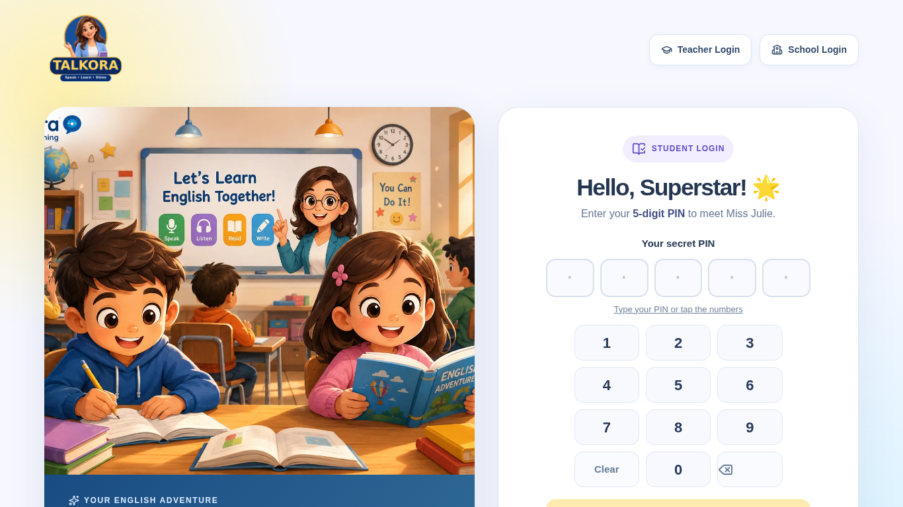
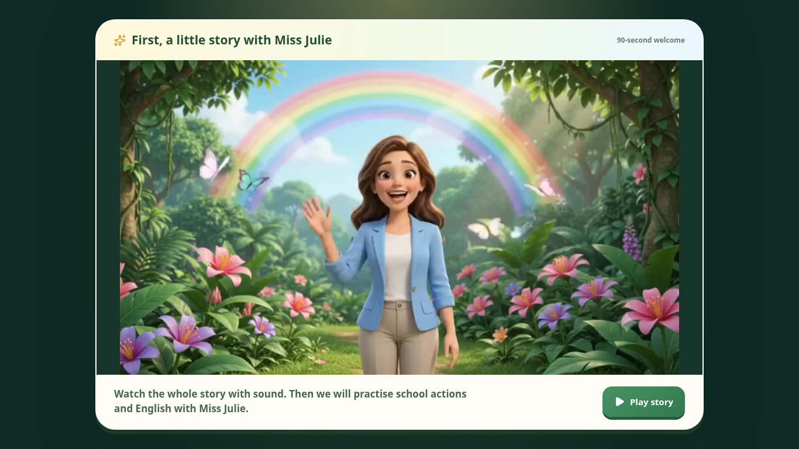

# Talkora engineering delivery — 10 November 2026

Six focused implementation batches and the prior read-only audit are available
for review. All PRs remain drafts and unmerged. Nothing was deployed, published,
migrated or changed in a real school's database. **Talkora is not certified
production-ready by this work.** Physical classroom speech, educator/media
approval, deployed integration and representative capacity evidence still block
that claim.

## Sources and architecture

The [read-only audit](engineering-audit-2026-11-10.md) records root causes,
affected files, severity, learner impact, proposed verification and hypotheses.
It was committed before implementation and remains a historical baseline.

| Source | Reviewed revision / disposition |
| --- | --- |
| App main | `b9da4b48c4641e74927e26f703fd2247521dc7e9`; includes merged #123/#124, neither repeated |
| AI main | `83b19973d28c41378a2b5be04bbaf7be4e3f8f4f` |
| [App #117](https://github.com/therealsaad/talkor/pull/117) | `ae7ff46008e58daafbb7a349639a177827d68728`; 30 changed files, shared Azure/auth/map overlap, merge conflicts; left untouched |
| [AI #20](https://github.com/therealsaad/talkora-ai-private/pull/20) | `0729bbf5fd8d339e33bd9ab10b7d57b146e09d17`; canonical poem context/at-at fix, tested separately and left unmerged |

The existing Next/React → authenticated Express → MongoDB and FastAPI stack
remains in place. Class 1 uses `talkora-ai-starter/server.main` and the
service-authenticated `/v1/brain/respond` contract. The obsolete `qwen-service`
was not used. Sarvam recognition, bounded Qwen coaching, Azure/approved S3 audio,
server evidence, signed audio delivery and authoritative progress remain the
teaching path. There is no architectural rewrite or dependency upgrade.

The Node context carries the authorized grade, lesson, scene key, actual current
teacher prompt, allowed vocabulary, objectives and student response. Existing
poem context protection keeps a stale word target from replacing the authored
poem. AI #20 additionally maps canonical `poem-pair-*` IDs, rejects unknown poem
scenes, uses reviewed fast responses for routine/help turns, and prevents the
legacy word guard from turning recitation into “at.” It does not publish the v4
poem draft. Azure rhythmic SSML is spoken recitation, not singing. Open questions
retain bounded Qwen and reviewed fallbacks; no model or speech provider success
is inferred from transport mocks.

## Implemented batches

| Audit ID | PR / head | Verified defect and resulting behavior |
| --- | --- | --- |
| A1 / P0 | [#126](https://github.com/therealsaad/talkor/pull/126), `a58a286` | Late auth restore/logout work could change the next learner's session. Concurrent restore is keyed to token and every delayed write/cleanup checks ownership. Same-token requests share only in flight; failures remain retryable. |
| A2 / P0 | [#127](https://github.com/therealsaad/talkor/pull/127), `c8ec7fb` | KG2–5 accepted a valid intro after ten seconds. Server durations now match the full packaged films: KG2/3/4 90 s, KG5 60 s. Existing ticket, expiry, visit and ended checks remain. |
| A4 / P1 | [#128](https://github.com/therealsaad/talkor/pull/128), `adb1bc0` | KG resume serialized three state APIs and fetched hidden HUD stats. One fresh authorized overview resolves the next route; simultaneous reads are token-owned, settled progress is never cached, hidden HUD work/flash is removed and failures offer retry. |
| A5 / P1, A11 evidence | [#129](https://github.com/therealsaad/talkor/pull/129), `71a80c3` | URL/error/provider logs could contain sensitive values. Request metrics use static routes, generated request IDs, bounded categories and status/timing; modified provider paths discard raw errors/bodies. Also fixes a Python timeout timer escaping configuration validation and adds a loopback-only load runner. |
| A3 / P0 | [#130](https://github.com/therealsaad/talkor/pull/130), `1a36e82` | Class 1 progress accepted a session ID without generated audio. Synthesis now speaks the saved teacher turn and issues a scoped expiring HMAC receipt only for validated complete audio. The browser records it only on current unmuted `ended`; signed ACK precedes idempotent progress. Login changes clear replay/cache/receipt state. |
| A6 / P0 | [#131](https://github.com/therealsaad/talkor/pull/131), `b71bdfe` | Class 1 intro enforcement existed only in React. Modern First Day practice now requires a full server-timed, school/student/lesson/media/auth-visit ticket. New PIN visits revoke older eligibility. Saved-progress resume also presents the film; starting/saving failures expose retry. |

The signed receipt mechanism is delivery evidence, not proof of physical hearing
or understanding. Browser media events are not a security attestation of a human
watching a screen. Existing lesson evidence still determines grades and XP. No
completion, mastery, publication or experience points were granted to real users.

## Controlled production-browser measurements

Real optimized Next build and HeadlessChrome 153, 1366×768, ten fresh contexts per
variant, serial measurements on the same host. Only HTTP responses are synthetic:
each API has a fixed 200 ms delay. Actual local assets/video decoding are used.
The run ends at the mandatory KG4 intro screen; it neither finishes the movie nor
uses a microphone. This isolates the removed request waterfall and HUD work.

| Metric | Before | After |
| --- | --- | --- |
| PIN submit → mandatory intro screen, p50 | 1,391 ms | 968 ms |
| PIN submit → mandatory intro screen, p95 | 1,436 ms | 1,045 ms |
| Navigation API requests | 7 | 4 |
| Browser resource requests | 66 | 42 |
| Observed resource transfer bytes | 763,333 | 706,512 |
| Observed layout shift score | 0.05564 | 0 |
| First usable PIN input, p50 / p95 | 241 / 301 ms | 238 / 295 ms |
| Heap range across fresh contexts | 6.45–7.18 MiB | 6.64–6.72 MiB |
| Long tasks across ten runs / maximum task | 13 / 106 ms | 18 / 101 ms |
| Media requests before PIN / microphone before intro | 0 / 0 | 0 / 0 |

PIN-to-intro p50 improved by 30.4%; p95 by 27.2% in this controlled scenario.
Long-task counts did not improve, so no general main-thread smoothness claim is
made. These small fresh-context samples cannot establish a memory leak bound,
school-network performance, cold remote asset bandwidth or full-session behavior.
Resource timing transfer totals are the browser's observed values for this run,
not a compressed JS bundle-size analysis. The original login's short-viewport
layout still merits a focused accessibility/usability pass.

[Before raw samples](evidence/2026-11-10/startup-before.json) and
[after raw samples](evidence/2026-11-10/startup-after.json) include request lists,
long tasks, heap and video readiness. The baseline includes auth ownership
hardening; the normal happy path is unchanged by that fix. The profile script is
in PR #128: `client/scripts/profile-kg-startup.mjs`.

These screenshots show existing approved assets and identity. The UI changes
remove transient HUD flicker and add honest recovery/permission waiting; no
unverified visual-system redesign or new artwork is presented as finished.

## Safe capacity measurements

The new runner accepts no external target or real credentials and creates only
its own loopback application and disposable MongoDB. Dataset: 10,000 synthetic
KG accounts in two synthetic schools, atomic Mongo rate limiting, 600 read-only
overview requests per stage. Node includes both server and load generator.

| Concurrent reads | Requests/s | p95 | Errors | Node peak RSS | Mongo resident after |
| --- | --- | --- | --- | --- | --- |
| 1 | 168.3 | 8.8 ms | 0/600 | 418 MiB | 193 MiB |
| 10 | 334.0 | 35.5 ms | 0/600 | 446 MiB | 193 MiB |
| 30 | 368.6 | 109.0 ms | 0/600 | 481 MiB | 198 MiB |
| 60 | 431.4 | 190.5 ms | 0/600 | 481 MiB | 205 MiB |

The table is the confirmation run after a clean TypeScript compilation of the
final #129 source. [Raw confirmation](evidence/2026-11-10/synthetic-load-confirmation.json)
and [initial results](evidence/2026-11-10/synthetic-load.json) also include CPU time,
p50/p99 and statuses. Increasing RSS includes seeding and generator work; it is
not a soak result. Rising latency/flattening throughput calls for separate-host
CPU/database profiling before sizing replicas. This is neither production
capacity nor 10,000 concurrent voice sessions. TLS/ingress, school NAT PIN bursts,
multi-node failure, provider quotas/costs and audio workloads were not exercised.

## Verification evidence

Tests use disposable data and synthetic provider transports. The repository CI
runner is the source of truth: `node tools/run-ci-locally.mjs`. No assertions were
weakened. Two old source-loader/arity expectations were updated to reflect the
real imported privacy helper and scoped voice argument, while retaining the
underlying privacy/language checks.

| Check | Evidence |
| --- | --- |
| AI main | 196 passed, 1 optional seed skipped; Starlette/httpx deprecation warning |
| AI #20 | 200 passed, 1 optional seed skipped; same warning; mocked Qwen transports |
| Auth behavioral regression | Five new cases failed before; 17 cases passed after |
| KG full-intro regression | Four early-completion cases failed before; 13 integration and seven UI contract cases passed after |
| KG resume | 15 integration and 11 focused client cases passed; cross-grade/role/draft locks retained |
| Class 1 signed feedback | 17 focused ACK/generation cases plus stream regressions passed; three HTTP/Mongo journey cases passed before combining with the intro gate; eight client playback/normalization cases passed |
| Class 1 server intro | 26 distinct integration cases across journey/demo/core/auth; six client cases and three real Chromium cases passed |
| Combined backend CI runner | 51 steps passed, 0 failed; dependency installation skipped locally; includes actual disposable Mongo checkpoint persistence/restart/races |
| Combined frontend CI runner | 28 node-test steps passed, 0 failed; both browser steps skipped by the path probe and then executed separately |
| Combined structure / build | Four structure steps and optimized Next production build passed |
| Combined real Chromium | 11 tests passed: eight staff boundary/journey cases and three Class 1 intro cases |
| Combined production preview smoke | Both `/classroom-preview` and `/classroom-preview.html` returned actual HTTP 404 |

[Machine-readable verification and commands](evidence/2026-11-10/verification.json),
[backend CI log](evidence/2026-11-10/combined-backend-ci.log),
[frontend CI log](evidence/2026-11-10/combined-frontend-ci.log),
[browser log](evidence/2026-11-10/combined-browser.log) and
[production build log](evidence/2026-11-10/combined-next-build.log) preserve the
combined results. Stored logs normalize terminal whitespace; test outcomes are
unchanged. Counts of CI steps are not counts of individual tests.

GitHub CI independently completed successfully for all six implementation heads:
[#126](https://github.com/therealsaad/talkor/actions/runs/42784157904),
[#127](https://github.com/therealsaad/talkor/actions/runs/42784644915),
[#128](https://github.com/therealsaad/talkor/actions/runs/42787278099),
[#129](https://github.com/therealsaad/talkor/actions/runs/42788686216),
[#130](https://github.com/therealsaad/talkor/actions/runs/42791450787),
[#131](https://github.com/therealsaad/talkor/actions/runs/42792942985).
These are development checks, not real provider/device or production acceptance.

Behavioral cases include delayed old-login success/401/failure, retry ownership,
wrong/missing/expired receipt, altered saved text, cross-student/activity/session/
login binding, bad/empty audio, abort/mute/error/late ended, double submission,
intro bypass attempts, early/forged/expired ticket, changed media, same-second
relogin, stale metadata and visible retry. Existing CI exercises curriculum gates,
teacher/school restrictions, shared Mongo limits, bounded provider fallbacks and
real checkpoint persistence/restart/races.

The system Chromium could not create its Unix singleton socket, and the cloud
browser could not reach loopback. An isolated headless Chromium runtime was used
for real production UI tests without changing application dependencies. The CI
preview smoke's default Next bind also hit `os.networkInterfaces` EPERM here;
the same real production HTTP 404 assertions were run using hostname 127.0.0.1.
This environment workaround is reported separately from passing repository CI.
A load confirmation initially could not start MongoDB through the test wrapper;
the direct cached MongoDB binary passed after a clean compile. The initial
failure is retained in the evidence folder. No application assertion was removed.
No synthetic Lighthouse score is substituted for classroom verification.

## Integration and rollout review

All six runtime branches were applied to a separate local verification branch;
main was not changed. The shared CORS change must retain **all three** exposed
headers: `X-KG-Feedback-Receipt`, `X-Class1-Feedback-Receipt`, `X-Request-Id`.
The Class 1 journey test conflict must retain both signed-feedback and intro
regressions and remove duplicate model imports. Auth provider changes must retain
both restore ownership and voice reset. These resolutions are captured in the
local integration evidence; no GitHub PR was automatically merged.
The tested local commit is `2aece4e624af7a50934c83d660daf2e57a5abdba`, tree
`f040e783f288a0280949516bce53f63f8cacfda2`.

Review order: #126, #127, #128, #129, then the coupled Class 1 #130/#131. Review
the existing #117 independently against these shared files and the current
poem/Azure/auth gates. AI #20 needs a separate owner review and coordinated Node/
Python revision acceptance. Do not enable a poem draft merely because its tests
pass.

Class 1 client/backend protocols must be released together after approval. Old
unsigned ACKs and intro-less clients fail closed. Verify the new intro collection's
declared unique/TTL indexes through the approved deployment process. No production
index or data migration ran here. Reverting the Class 1 protocols requires
coordinated client/server rollback with affected material unavailable until the
security gates work again. Other batches are code reverts; student progress is
never rolled back. Review privacy before restoring legacy URL/error logging.

## Preserved protections and remaining release blockers

- Five-digit PIN-only student form, distinct staff login, token ownership and
  student session expiry remain. Auth tests retain true 401 and offline semantics.
- Full introductory videos, approved Miss Julie asset paths, microphone/audio
  sequencing, fresh automatic resume and completed-lesson revision are preserved.
- Signed KG ACKs and new Class 1 ACKs do not change grading/publication authority.
  Deterministic server evidence owns progression and XP; Qwen cannot publish.
- KG6–10 and unapproved Class 1 material remain locked. No curriculum record,
  educator approval, media approval or release status was invented or changed.
- No real pupil record, recording, PIN, token or transcript was used in development
  or the submitted evidence. Modified diagnostics are privacy tested; historical
  optional providers and deployed infrastructure retention still need review.

Still required before a school pilot:

1. Educator sign-off on the exact active book/version, lesson objectives, approved
   intro/media, bilingual corrections, original poem lines and publication scope.
2. A real school computer's physical mic → Sarvam → authorized Node/FastAPI/Qwen
   → Azure/S3 → speaker → saved progress → logout/new-PIN resume journey, including
   wrong/unclear/silent/unexpected child speech, code switching and revision.
3. Measure speech-end → first audible response, STT, AI, TTS, audio download,
   playback and recovery on cold/warm school networks. Cached-response p50 <1 s
   and interactive p95 <3 s remain **targets, not verified results**. Class 1 full
   pipeline telemetry is still incomplete; do not infer it from KG startup timing.
4. Reviewed staging deployment: Node/Python revision alignment, service keys,
   CORS/ingress proxy trust, signed protected audio, S3 permissions, provider
   readiness/quotas, session expiry, index creation, backups and a rehearsed rollback.
   `/health` is still liveness only; bounded readiness diagnostics remain open.
5. Authorized staging capacity/soak and fault tests with a realistic active voice
   mix, school NAT sign-in bursts, multiple replicas, network disconnects and
   resource/cost budgets. Separate enrollment from active speech concurrency.
6. Modest-computer and small-screen/reduced-motion/accessibility testing, a
   same-browser long-session heap profile, request/CPU traces and review of
   residual long tasks. Broad visual-system standardization remains unfinished.
7. Owner review of branch protection/required reviews/checks; main was reported
   unprotected. No repository administration settings were changed.

The next highest-value batch is a reviewed Class 1 Node/Python contract acceptance
with AI #20, privacy-safe complete voice timing and bounded readiness diagnostics,
followed by the real school-device acceptance above. Query/asset consolidation
should follow measurements, without caching authorization/progress or opening
unapproved curriculum.
